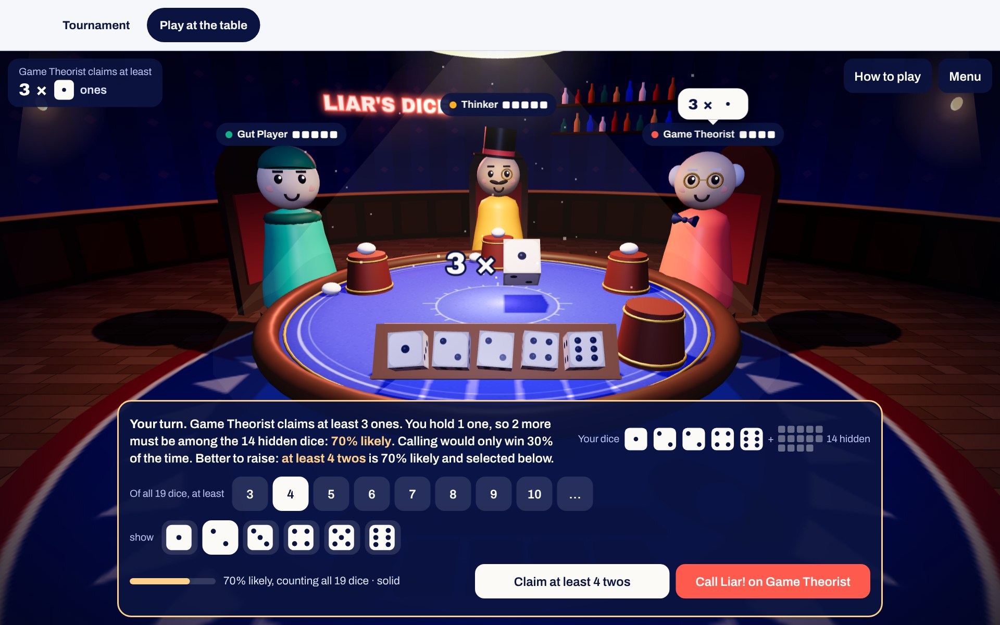

# Liar's Dice Invitational

Six AIs that each learned to bluff in a different way, a tournament between them, and a 3D table where you sit down and play them yourself.

> **Made for fun with [Claude Code](https://claude.com/claude-code).**
> This started as "I'm bored, what can we make?" The game, the six AIs, their training and this page all came out of that one conversation. It's a toy project, not research.

**Play it:** https://atharva309.github.io/Liars-dice/




## What's here

- **Play at the table.** A first-person 3D table against three AIs you pick, with 2, 3 or 5 dice each. Optional coach tips show the odds of every claim and suggest a move.
- **Tournament.** How the AIs did against each other: one-on-one ratings, four-player win rates, a head-to-head grid, training curves, and how often each one bluffs.

## The rules in 30 seconds

1. Everyone rolls their dice under a cup. You only see your own.
2. On your turn you make a claim about **all the dice on the table**, such as "at least 3 fives". Each claim must be higher than the last: more dice, or the same count with a higher number.
3. Instead of raising, you can call **Liar!** on the claim before yours. All cups lift and the dice are counted.
4. If the claim was true, the caller loses a die. If it was false, the claimer does. Nobody ever gains a die.
5. Lose all your dice and you're out. Last player with dice wins.

## The six AIs

| Name | Method | How it learns |
|---|---|---|
| Game Theorist | CFR (counterfactual regret minimization) | Tracks how much it regrets not having made each move. The family of methods behind the poker bots. |
| Exploiter | DQN (deep Q-learning) | Scores every move and always plays the top one. |
| Gut Player | PPO (policy gradient) | Learns move probabilities directly, so it mixes its play. |
| Hybrid | NFSP (neural fictitious self-play) | One network hunts for the best reply, a second averages its own past play. |
| Old-Schooler | Monte Carlo control | A lookup table updated only from who won each round. |
| Thinker | ISMCTS (tree search) | No training. Each turn it imagines the hidden dice and simulates ahead. |

Two hand-written bots fill out the field: the **Math Bot**, which always makes the most likely claim and calls when the odds say so, and the **Random Bot**.

## Results

Share of four-player games won, over 4,000 games per mode with random seatings. An average player wins 25%.

| | 5 dice each | 3 dice | 2 dice |
|---|---|---|---|
| Exploiter (DQN) | **42%** | **38%** | 30% |
| Gut Player (PPO) | 37% | 36% | **38%** |
| Old-Schooler (Monte Carlo) | 33% | 32% | 32% |
| Hybrid (NFSP) | 28% | 28% | 25% |
| Game Theorist (CFR) | 26% | 30% | 21% |
| Thinker (ISMCTS) | 18% | 20% | 22% |
| Math Bot | 15% | 16% | 31% |
| Random Bot | 0% | 0% | 0% |

One-on-one (2 dice each), Elo fitted from a full round robin: Game Theorist 1611, Thinker 1594, Math Bot 1591, Gut Player 1577, Hybrid 1554, Exploiter 1540, Old-Schooler 1538, Random Bot 994.

A few things that stood out:

- **No method wins everywhere.** CFR is the best one-on-one player and near the bottom at a four-player table. Its guarantee of being hard to exploit only holds for two players.
- **Self-play alone broke the Exploiter.** Trained only against copies of itself at 5 dice, it won about 8% of games against Math Bots. Putting a Math Bot in some seats during training fixed it.
- **Playing the raw odds stops being enough.** The Math Bot is competitive at 2 dice and falls well behind once there are more dice to bluff with.

## How it works

**2 dice each.** The game is small enough that each agent learns it directly, with a table or a small network over every situation. The one-on-one Game Theorist uses full-width CFR+.

**3 and 5 dice each.** There are far too many situations to memorise, so every agent chooses from a shortlist and sees each option through the odds:

- The shortlist holds up to 18 claims plus calling. For each face it has the cheapest legal raise, the biggest claim that is at least 50% likely given your own dice, and the biggest that is at least 25% likely.
- Each option is described by 15 numbers, such as how likely it is to be true, how big a jump it is, and how likely the current claim is.
- The neural agents score each option with a 15-48-48-1 network. The table agents group options into 31 kinds of move.
- One trained agent then plays any dice count from 1 to 5.

Other details:

- Agents are rewarded per round: lose a die and you're penalised, otherwise you share a small reward.
- At 3 and 5 dice the Game Theorist uses external-sampling MCCFR, the sampling scheme Pluribus used, and plays its final strategy. Its long-run average, which is what the theory is about, played far worse at four players.
- Networks and training are plain NumPy, on CPU, a few minutes per agent.
- The 3- and 5-dice tournaments were run with the same JavaScript this page ships, so the win rates describe the agents you actually play.

## Run it locally

```
python3 -m http.server 8000
```

Then open http://localhost:8000. It needs a local server because the page fetches the agent files, and an internet connection for three.js and the fonts, which load from public CDNs.

## Files

- `index.html`: the page and the tournament tab, with results inlined
- `table.js`: the 3D table, the rules, and the code that runs the agents in the browser
- `ai/`: trained agents for the 2-dice game
- `ai5/`: trained agents for 3 and 5 dice
- `screenshots/`: the images above

The Python training code is not in this repository.

## Limitations

- These are small games with short training runs. The agents are fun opponents, not strong players by serious standards.
- The Thinker is weak at 5 dice. Its search uses a simple playout and wasn't tuned for the bigger game.
- No wild ones and no "exact" call, so there is no way to win a die back.

---

Built with [Claude Code](https://claude.com/claude-code), for fun.
