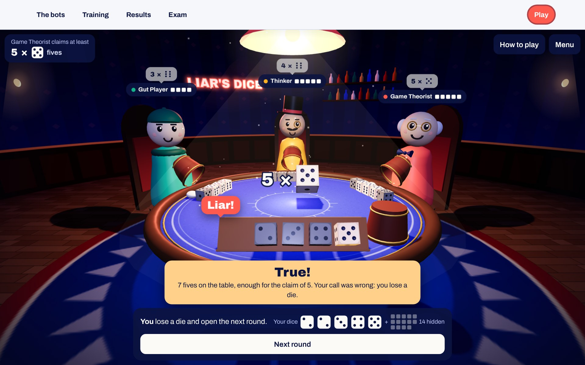

# Liar's Dice Invitational

Six AIs that each learned to bluff in a different way, a tournament between them, and a 3D table where you sit down and play them yourself.

> **Made for fun with [Claude Code](https://claude.com/claude-code).**
> This started as "I'm bored, what can we make?" The game, the six AIs, their training and this page all came out of that one conversation. It's a toy project, not research.

**Play it:** https://atharva309.github.io/Liars-dice/




## What's here

The page reads as a short story in four chapters, followed by the game itself:

1. **The bots.** Who the eight players are and how each one thinks.
2. **Training.** The loop every learner ran, and what changed between the first version and the current one.
3. **Results.** Four-player standings, new bots against old, one-on-one records, and how each bot plays.
4. **Exam.** Two papers with right answers: an answer key for small endgames, and a "hunter" that finds each bot's worst-case opponent.
5. **Play.** A first-person 3D table against three AIs you pick, with 2, 3 or 5 dice each. Optional coach tips show the odds and suggest a move.

## The rules in 30 seconds

1. Everyone rolls their dice under a cup. You only see your own.
2. On your turn you make a claim about **all the dice on the table**, such as "at least 3 fives". Each claim must be higher than the last: more dice, or the same count with a higher number.
3. Instead of raising, you can call **Liar!** on the claim before yours. All cups lift and the dice are counted.
4. If the claim was true, the caller loses a die. If it was false, the claimer does. Nobody ever gains a die.
5. Lose all your dice and you're out. Last player with dice wins.

## The six AIs

| Name | Method | How it learns |
|---|---|---|
| Gut Player | PPO (policy gradient) | Makes the moves that came before good results a little more likely. It mixes its play, so it is hard to read. |
| Exploiter | DQN (deep Q-learning) | Learns a score for every move and always plays the highest. |
| Old-Schooler | Monte Carlo control | A lookup table of situations, nudged by how each round ended. |
| Hybrid | NFSP (neural fictitious self-play) | One network hunts for the best reply, a second averages its own past play. |
| Game Theorist | CFR (counterfactual regret minimization) | Tracks how much it regrets not having made each move. The family of methods behind the poker bots. |
| Thinker | ISMCTS-style search | No training of its own. Each turn it imagines the hidden dice and plays the round out many times, using a small learned model of how the others bid. |

Two hand-written bots fill out the field: the **Math Bot**, which always makes the most likely claim and calls when the odds say so, and the **Random Bot**.

## How they are trained

Nobody gave the bots a strategy. Each learner starts out making random claims and then repeats one loop a few hundred thousand times:

1. **Sit down with a crowd.** Each practice round seats the learner with copies of itself, the first version of every bot, and the Math Bot. A second phase adds the new bots as opponents for each other.
2. **Read the table.** The bot sees a shortlist of up to 24 claims and the chance each is true. That chance is adjusted by the bidding: a fitted table says how many of a face a player probably holds given what they have claimed so far.
3. **Get one number back.** When the round ends, the bot is told how much its estimated chance of winning the whole game moved. Losing a die costs more the fewer you have left.
4. **Adjust and repeat.** Each method uses that number differently, which is the only real difference between the bots.

Practice per bot ranged from 120,000 to 1.4 million rounds, about 4 to 13 minutes each on one CPU core.

The bots were trained twice. What changed between the first version and the current one:

| | First version | Now |
|---|---|---|
| Opponents in training | Mostly copies of itself | Itself, every earlier bot, the Math Bot, then each other |
| Odds | Pure chance: every hidden die is 1 in 6 | Adjusted by what each player has bid |
| Rewarded for | Not losing a die this round | Raising its chance of winning the game |
| Options per turn | Up to 18 claims | Up to 24 claims |
| The Thinker | Assumes everyone plays the raw odds | Simulates with a learned model of the others |

## Results

Share of four-player games won, 2,500 games per dice count with random seatings. An average player wins 25%.

| | 5 dice each | 3 dice | 2 dice |
|---|---|---|---|
| Gut Player (PPO) | **39%** | **39%** | **38%** |
| Exploiter (DQN) | 33% | 29% | 27% |
| Hybrid (NFSP) | 31% | 28% | 29% |
| Thinker (ISMCTS) | 28% | 33% | 32% |
| Old-Schooler (Monte Carlo) | 28% | 27% | 27% |
| Game Theorist (CFR) | 26% | 26% | 27% |
| Math Bot (hand-written) | 17% | 18% | 20% |
| Random Bot (hand-written) | 0% | 0% | 0% |

**New against old.** The middle columns come from one mixed field of all twelve bots (2,500 games, 5 dice each). The last column seats each new bot with three copies of its first version (500 games), where 25% would mean no change.

| | First version, mixed field | Current, mixed field | Current vs three of its first version |
|---|---|---|---|
| Gut Player | 26% | 37% | 35% |
| Exploiter | 29% | 37% | 27% |
| Hybrid | 22% | 29% | 37% |
| Thinker | 12% | 27% | 53% |
| Old-Schooler | 20% | 25% | 33% |
| Game Theorist | 18% | 19% | 29% |

On average the current bots won 29% of their mixed-field games and the first versions 21%.

**One on one** (5 dice each, 120 games per pairing, Elo fitted from the round robin): Gut Player 1679, Exploiter 1659, Game Theorist 1599, Old-Schooler 1592, Hybrid 1588, Math Bot 1584, Thinker 1564, Random Bot 735.

What stood out:

- **The retraining worked.** In one mixed field of all twelve bots, new and old, the new ones won 29% of their games and the first versions 21%. Every new bot finished ahead of its old self, though the Game Theorist's edge (19% against 18%) is too small to be sure of.
- **The Thinker gained the most.** It went from 12% to 27% in the mixed field, and wins 53% of its games against three copies of its old self. It now weighs the hidden dice by the bidding and plays its simulations out with a learned model of the others.
- **The Gut Player is the one to beat.** It tops the four-player standings at 5, 3 and 2 dice (39%, 39%, 38%) and has the best one-on-one rating. Head to head the field is much tighter: only the Gut Player and the Exploiter are clearly ahead of the Math Bot. The learners practised at four-player tables, and it shows.

## The exam

Win rate against each other can hide habits that every bot shares, so the bots also sit an exam with right answers. Both papers are computed exactly instead of estimated from games.

**Paper A, the answer key.** One-on-one endgames with up to three dice on the table are solved completely: 7.1 million situations, each with a known best move. The table shows the share of a bot's moves that are the best move, or within half a point of it, for three versions of each bot.

| | First version | Halfway through retraining | Now | Hard questions, now |
|---|---|---|---|---|
| Gut Player | 89% | 93% | 94% | 87% |
| Exploiter | 99% | 87% | 86% | 79% |
| Old-Schooler | 87% | 86% | 96% | 75% |
| Hybrid | 88% | 88% | 89% | 87% |
| Game Theorist | 87% | 93% | 96% | 82% |
| Thinker* | 84% |  | 84% | 59% |
| Math Bot |  |  | 86% | 0% |

Hard questions are the 8% of decisions where playing the raw odds gives the wrong move, so the Math Bot scores 0% on them by definition. *The Thinker is a randomised search with no halfway version. It was marked on sampled rounds, so its figures are good to about 2 points.

**Paper B, the hunter.** For each bot, the best possible counter-strategy against that bot's actual habits. Nothing can beat the bot by more. Each cell shows how often the hunter wins against the first version → halfway → now. Lower is better for the bot.

| | Four players, 2 dice each (25% is an even share) | Duel, 2 dice each (50% means it cannot be exploited) |
|---|---|---|
| Gut Player | 45% → 60% → 57% | 80% → 91% → 95% |
| Exploiter | 80% → 75% → 83% | 95% → 97% → 91% |
| Old-Schooler | 89% → 77% → 77% | 99% → 97% → 94% |
| Hybrid | 81%+ → 60%+ → 62%+ | 91% → 88% → 87% |
| Game Theorist | 57% → 67% → 69% | 86% → 90% → 92% |
| Math Bot | 69% | 79% |

A plus sign means "at least": that bot mixes its play too much to pin the figure down. The Thinker has no hunter score because its move chances cannot be written down exactly. The hunter knows a bot's habits exactly, so these are worst cases, not what a person at the table would get.

What the exam says:

- **Retraining taught the hard decisions.** On the questions where the raw odds mislead, the Game Theorist went from 11% to 82% and the Gut Player from 24% to 87%. Four of the five learners now score higher on the whole paper than their first version did. The Exploiter scores lower.
- **It did not make them harder to exploit.** At a four-player table with 2 dice each, the hunter wins more against today's Gut Player (45% before, 57% now), Exploiter (80%, 83%) and Game Theorist (57%, 69%) than against their first versions. Only the Old-Schooler and the Hybrid got harder to exploit.
- **A high mark is not the same as safe.** The first Exploiter scored 99% on the answer key, yet the hunter beats it in 95% of duels. It plays good moves but always the same ones, so a counter-strategy can be built around them. That is why the exam needs both papers.

Two leaks it found, both for when it is down to you and one bot with 2 dice each:

- **Exploiter.** Open with two of a low number you do not hold (ones, twos or threes). It always raises to three of that number, which cannot be true. Call it.
- **Gut Player.** When it makes the first claim of a round, it names a number it does not hold. Call Liar unless you hold that number yourself.

## How it works

- **Shortlist.** For each face a bot considers the cheapest legal raise and the biggest claims that are at least 75%, 50% and 25% likely, plus calling. That is at most 24 claims.
- **Reading the bidding.** A table fitted from the bots' own games gives the distribution of how many of a face a player holds, given how often they have bid that face this round. All probabilities are computed from it.
- **Playing for the game.** A player's chance of winning is modelled as their dice count to the power 2.9, as a share of everyone's. This was fitted from games and checked for calibration. The reward for a round is the change in that share.
- **Networks and tables.** Each option is described by 24 numbers. The neural bots score options with a 24-64-64-1 network. The table bots group situations into 600 kinds and moves into 43.
- **The Thinker.** It samples possible hands for the other players, weighted by their bids, tries each shortlisted move on the same sampled deals, and plays every round out with a small network distilled from the Gut Player.
- **Game Theorist.** External-sampling Monte Carlo CFR, from the same family of methods as the poker bot Pluribus, with some seats played by the crowd. It plays its final strategy: the long-run average, which is what the theory is about, tested much worse at four players.
- **Same code everywhere.** Training is plain NumPy. Every tournament game was played by the JavaScript this page ships, and that JavaScript is checked move for move against the training code.

## Run it locally

```
python3 -m http.server 8000
```

Then open http://localhost:8000. It needs a local server because the page fetches the bot files, and an internet connection for three.js and the fonts, which load from public CDNs.

## Files

- `index.html`: the three chapters, with results inlined
- `table.js`: the 3D table, the rules, and the code that runs the bots in the browser
- `bots/`: the trained bots and the two small models they share
- `screenshots/`: the images above

The training code, every earlier version of the bots, and the exam code are on the [`exam-lab` branch](https://github.com/Atharva309/Liars-dice/tree/exam-lab/lab) under `lab/`.

## Limitations

- These are small experiments with minutes of training on a CPU. The bots are fun opponents, not strong players by serious standards.
- Tournament results are bot against bot. How they fare against people is untested.
- The exam's answer key only covers one-on-one endgames with up to three dice on the table. Nobody has an answer key for the full game.
- The Game Theorist remains the weakest learner at a four-player table. CFR's guarantees only hold for two players.
- No wild ones and no "exact" call, so there is no way to win a die back.

---

Built with [Claude Code](https://claude.com/claude-code), for fun.
